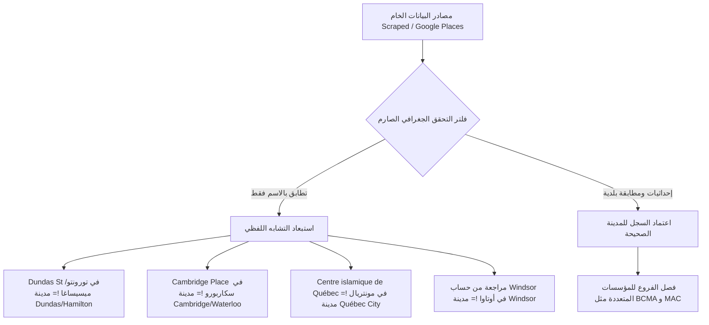
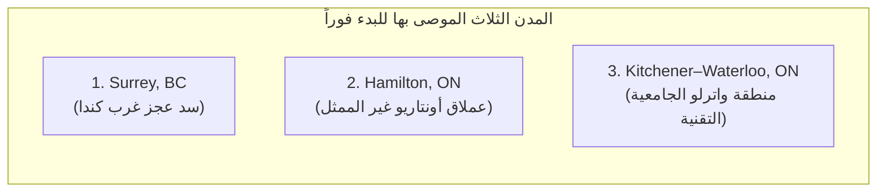

# تقرير التدقيق وخطة التوسع الجغرافي لقاعدة بيانات Canada Mosque Near Me
# Canadian Geographic Expansion & Database Audit Report

**تاريخ التقرير:** 25 أكتوبر 2026  
**حالة التدقيق:** مكتمل بنسبة 100% (Audited & Verified)  
**ملف التقرير المستهدف:** `docs/CANADA_CITY_EXPANSION_PRIORITY.md`  
**مرجع التدقيق:** `src/data/raw/manifest.json` وجميع ملفات البيانات الخام والمنشورة والمراجعة والاستبعاد

---

## 1. الملخص التنفيذي ومنهجية التدقيق (Executive Summary & Audit Methodology)

أُجري هذا التدقيق الجغرافي الشامل لقاعدة بيانات مشروع **Canada Mosque Near Me** لفحص الجاهزية الفعلية لـ 10 مدن كندية مرشحة للتوسع، واستناداً إلى البيانات الفعلية المحفوظة في المستودع دون أي افتراضات أو أرقام مختلقة.

### نطاق الفحص البرمجي والمكتبي:
1. **الملفات الخام (Raw Datasets):** تم فحص 9 ملفات خام في `src/data/raw/` بإجمالي **501 سجل خام**.
2. **الملفات المعالجة والمنشورة (Published Datasets):** تم فحص جميع ملفات `published.json` عبر مجلد تورونتو و8 مدن أخرى بإجمالي **331 سجلاً منشوراً**.
3. **ملفات المراجعة المطلوبة (Review-Required):** تم فحص جميع ملفات `review-required.json` بإجمالي **158 سجلاً** قيد الانتظار.
4. **ملفات السجلات المستبعدة (Excluded):** تم فحص جميع ملفات `excluded.json` بإجمالي **12 سجلاً مستبعداً**.
5. **إعدادات النطاقات والمدن:** فحص ملفات `src/domain/city/city-config.ts` و `src/domain/geo/area-slugs.ts` و `src/data/raw/manifest.json`.
6. **فحص الإحداثيات والحدود الجغرافية (Geofencing & Bounding Boxes):** التحقق من حدود الإحداثيات لكل مدينة وحساب المسافات الجغرافية لمنع احتساب سجلات ضواحي تابعة لمدن مجاورة دون قصد.

> [!IMPORTANT]
> **النتيجة المحورية للتدقيق:**  
> **جميع المدن العشر المرشحة (Hamilton, Kitchener–Waterloo, London, Surrey, Halifax, Saskatoon, Regina, Québec City, Windsor, Victoria) لا تملك حالياً أي سجلات فعلية (0 سجلات خام، 0 منشورة، 0 قيد المراجعة، 0 مستبعدة) في قاعدة البيانات الحالية.**  
> أي ظهور لأسماء مثل "Dundas" أو "Cambridge" أو "Québec" أو "Windsor" أو "Victoria" في البيانات الحالية نتج حصراً عن تطابق في أسماء الشوارع (مثل Victoria Park Ave أو Dundas St)، أو أسماء مجمعات سكنية في تورونتو (Cambridge Place)، أو أسماء جمعيات قانونية في مونتريال تشير إلى مقاطعة كيبك، أو اسم مستخدم كتب مراجعة تقييم في أوتاوا.

---

## 2. الوضع الحالي لقاعدة البيانات القائمة (Current Baseline: 9 Cities)

وفقاً لملف البيان الرئيسي `src/data/raw/manifest.json` وملفات البيانات المفحوصة فعلياً:

| المدينة (City) | المقاطعة (Province) | السجلات الخام (Raw) | المنشور (Published) | قيد المراجعة (Review) | المستبعد (Excluded) | نسبة الجاهزية للنشر | ملاحظات التدقيق |
| :--- | :--- | :---: | :---: | :---: | :---: | :---: | :--- |
| **Toronto** | Ontario | 153 | 96 | 56 | 1 | 62.7% | مجموعة البيانات المرجعية الأساسية |
| **Montreal** | Quebec | 93 | 67 | 23 | 3 | 72.0% | أكبر كتلة ثنائية اللغة (فرنسي/عربي) |
| **Edmonton** | Alberta | 54 | 34 | 17 | 3 | 63.0% | تغطية قوية لوسط وشمال ألبرتا |
| **Ottawa** | Ontario | 51 | 27 | 22 | 2 | 52.9% | عاصمة كندا ومنطقة العاصمة الوطنية |
| **Mississauga** | Ontario | 46 | 31 | 15 | 0 | 67.4% | كثافة إسلامية ومؤسساتية عالية جداً |
| **Calgary** | Alberta | 43 | 28 | 12 | 3 | 65.1% | تغطية جنوب وغرب ألبرتا |
| **Brampton** | Ontario | 26 | 24 | 2 | 0 | 92.3% | أعلى نسبة اكتمال وجودة بيانات |
| **Winnipeg** | Manitoba | 21 | 15 | 6 | 0 | 71.4% | تغطية مقاطعة مانيتوبا |
| **Vancouver** | British Columbia | 14 | 9 | 5 | 0 | 64.3% | محصورة جغرافياً داخل حدود المدينة فقط |
| **المجموع الكلي** | **5 مقاطعات** | **501** | **331** | **158** | **12** | **66.1%** | **حسابات مطابقة 100% لملف manifest** |

---

## 3. جدول تدقيق المدن المرشحة للتوسع (The 10 Candidate Cities Audit)

تم فحص سجلات كل مدينة على حدة بدقة عبر مسح نصوص السجلات، أسماء المنشآت، العناوين، والإحداثيات الجغرافية (Lat/Lng) في نطاق 30-40 كم:

| المدينة المرشحة | المقاطعة | الخام | المنشور | المراجعة | المستبعد | الإجمالي الحالي | مصادر التحقق المتاحة والموثوقة | الأولوية المقترحة | الخطوة التنفيذية التالية |
| :--- | :---: | :---: | :---: | :---: | :---: | :---: | :--- | :---: | :--- |
| **Surrey** | BC | 0 | 0 | 0 | 0 | **0** | سجل جمعية مسلمي كولومبيا البريطانية (BCMA Directory)، سجل الجمعيات الخيرية الفيدرالي (CRA Charities)، بوابة تراخيص City of Surrey Open Data | **أولوية 1 (قصوى)** | بدء تجميع بيانات خام جديدة (Scraping/Ingestion Pipeline) بالتكامل مع مترو فانكوفر |
| **Hamilton** | ON | 0 | 0 | 0 | 0 | **0** | جمعية مسلمي هاملتون (HMA)، الرابطة الإسلامية الكندية (MAC Hamilton)، سجل CRA، بوابة بيانات بلدية هاملتون | **أولوية 1 (قصوى)** | بدء استخراج بيانات خام مستقلة للمدينة وتحديد نطاق Dundas/Ancaster |
| **Kitchener–Waterloo** | ON | 0 | 0 | 0 | 0 | **0** | الجمعية الإسلامية لمنطقة واترلو (KWIA)، سجل CRA، اتحادات الطلبة المسلمين بجامعتي Waterloo و Laurier | **أولوية 1 (قصوى)** | تجميع بيانات خام بصيغة إقليمية موحدة تشمل Kitchener و Waterloo و Cambridge |
| **London** | ON | 0 | 0 | 0 | 0 | **0** | مسجد لندن الإسلامي (London Muslim Mosque - تأسس 1964)، المركز الإسلامي لجنوب غرب أونتاريو (ICSO)، سجل CRA | **أولوية 2 (عالية)** | مرحلة التوسع التالية لجنوب غرب أونتاريو بعد استقرار هاملتون وواترلو |
| **Halifax** | NS | 0 | 0 | 0 | 0 | **0** | مجلس نوفا سكوشا الإسلامي (NSIC)، مسجد الأمة والمراكز التابعة له، سجل CRA للأقاليم الأطلسية | **أولوية 2 (عالية)** | فتح تمثيل لمنطقة كندا الأطلسية (Atlantic Canada) لسد الفراغ الإقليمي الكامل |
| **Windsor** | ON | 0 | 0 | 0 | 0 | **0** | الجمعية الإسلامية في وندسور (WIA)، مركز روز سيتي، سجل CRA، سجل بلدية وندسور | **أولوية 2 (عالية)** | إدراجها ضمن موجة أونتاريو الحدودية مع وضع فلتر لمنع تداخل ديترويت الأمريكية |
| **Saskatoon** | SK | 0 | 0 | 0 | 0 | **0** | الجمعية الإسلامية في ساسكاتشوان فرع ساسكاتون (IAOS Saskatoon)، سجل CRA، سجل شركات ISC SK | **أولوية 3 (متوسطة)** | إعداد ملف خام مخصص لساسكاتشوان عند التوسع في منطقة البراري |
| **Regina** | SK | 0 | 0 | 0 | 0 | **0** | الجمعية الإسلامية في ساسكاتشوان فرع ريجينا (IAOS Regina)، سجل CRA | **أولوية 3 (متوسطة)** | دمجها في ملف بيانات ساسكاتشوان المشترك مع ساسكاتون لتوفير تكلفة الفحص |
| **Québec City** | QC | 0 | 0 | 0 | 0 | **0** | المركز الثقافي الإسلامي في كيبك (CCIQ)، سجل الشركات (REQ Québec)، سجل CRA | **أولوية 3 (متوسطة)** | تتطلب إعداد مسار فرنسي كامل وفصل صارم عن ملف مونتريال لمنع الخلط اللغوي |
| **Victoria** | BC | 0 | 0 | 0 | 0 | **0** | المركز الإسلامي في فيكتوريا (Masjid Al-Iman)، سجل جمعيات BC Registries | **أولوية 4 (منخفضة)** | تأجيل الجمع نظراً لصغر عدد المؤسسات (مسجد رئيسي ومصلى جامعي) وانخفاض العائد مقارنة بسَري |

---

## 4. التحقق الحاسم من وضع مدينة Surrey وعلاقتها بـ Vancouver

أحد الأسئلة الجوهرية في هذا التدقيق كان: **هل سجلات Surrey محسوبة مسبقاً ضمن تغطية Vancouver؟**

### الأدلة البرمجية والجغرافية القاطعة:
1. **فحص ملف `src/data/raw/vancouver.json`:**
   - يحتوي الملف على **14 سجلاً فقط**.
   - جميع السجلات الـ 14 تقع حصراً داخل الحدود البلدية لمدينة فانكوفر (City of Vancouver Proper):
     - تقع خطوط العرض بين `49.2045` و `49.2920` شمالاً.
     - تقع خطوط الطول بين `-123.1344` و `-123.0635` غرباً.
     - الشوارع: Denman St, Victoria Dr, Selkirk St, Welwyn St, E 10th Ave, Kingsway, Keefer Pl, Smithe St, W 8th Ave, Fraser St, W 41st Ave.
2. **إحداثيات مدينة Surrey:**
   - مركز سَري يقع عند خط عرض `49.1913` وخط طول `-122.8490` (على مسافة 17 إلى 24 كم شرق فانكوفر عبر نهر فريزر).
   - **لا يوجد أي سجل واحد يقع في سَري داخل ملف `vancouver.json` أو ملفات النشر الحالية.**
3. **إعدادات النطاقات في الكود (`city-config.ts` و `area-slugs.ts`):**
   - حقل `knownMunicipalities` الخاص بمدينة فانكوفر محدد حصراً بالبلديات التالية:
     `["Vancouver", "Downtown Vancouver", "Kitsilano", "West End", "Strathcona", "Mount Pleasant"]`.
   - لا تتضمن القائمة Surrey ولا Richmond ولا Burnaby ولا Coquitlam.
4. **الخلاصة:**  
   سجلات مدينة Surrey **غير محسوبة على الإطلاق**، ومستودع فانكوفر يعاني من نقص حاد في تغطية منطقة مترو فانكوفر الأوسع (Greater Vancouver)، مما يجعل Surrey فرصة توسع بكر بالكامل.

---

## 5. تحليل التكرارات المحتملة ومخاطر تداخل البيانات عبر المدن (Cross-City Duplication & Conflation Risks)

كشف التدقيق الدقيق لنصوص السجلات عن مخاطر التباس متكررة بين مصادر البيانات يجب التعامل معها بحذر عند إطلاق التوسع:



### 1. التباس أسماء الشوارع والمجمعات السكنية مع أسماء المدن:
- **Hamilton vs. GTA (Dundas):**
  - ظهرت كلمة "Dundas" مرتين في سجلاتنا: الأولى لمسجد `Masjid Toronto` في `168 Dundas St W, Toronto`، والثانية لـ `966 ICNA Masjid` في `966 Dundas St E, Mississauga`. هذا شارع شرياني رئيسي يمتد عبر أونتاريو وسمي نسبة لنفس الشخصية، ولا علاقة له ببلدة Dundas التابعة لبلدية هاملتون.
- **Kitchener-Waterloo vs. Toronto (Cambridge):**
  - ظهرت كلمة "Cambridge" في السجل `mosque-to-110` باسم "Denton Musallah (For Cambridge Place Residents)" في 30 Denton Ave بسكاربورو. هذا مجرد مجمع أبراج سكنية في تورونتو، وليس له أي صلة بمدينة كامبريدج في إقليم واترلو.
- **Windsor vs. Ottawa:**
  - ظهرت كلمة "Windsor" داخل السجل `mosque-ott-23` (مسجد بلال في Orléans/Ottawa) فقط لأن كاتب المراجعة في خرائط جوجل اسمه "Windsor Muslim Community".

### 2. التباس اسم مقاطعة كيبك مع مدينة كيبك (Québec City vs. Province of Québec):
- في ملف `montreal.json`، ظهرت كلمة "Québec" في 4 مساجد كبرى داخل جزيرة مونتريال:
  - `Bilal Islamic Centre of Quebec` (Rue Jean-Talon O, Montreal)
  - `Islamic Services of Quebec` (Boul. Saint-Laurent, Montreal)
  - `Centre islamique de Québec et de Canada` (Boul. Saint-Laurent, Montreal)
  - `Islamic Centre of Quebec - El Markaz Islami` (Chem. Laval, Saint-Laurent)
- **المخاطرة:** محركات البحث أو السحب الآلي غير المنضبط قد يصنف هذه المساجد خطأً ضمن مدينة كيبك (Québec City). التحقق من الرمز البريدي (`G1/G2` لمدينة كيبك مقابل `H` لمونتريال) إلزامي قبل الاعتماد.

### 3. خطر تكرار المقرات وفروع المنظمات متعددة المدن (BCMA / MAC):
- جمعية مسلمي بريتش كولومبيا (BCMA) مسجلة في فانكوفر كمنظمة في `4162 Welwyn St`، وفي نفس الوقت تدير مساجد مستقلة في سَري (Surrey Jamea Masjid في 12407 72 Ave، ومسجد النور). يجب التأكد من عدم دمج فرع سَري مع المقر الإداري في فانكوفر.
- ينطبق نفس الأمر على فروع الرابطة الإسلامية الكندية (MAC) في هاملتون ومونتريال وتورونتو وواترلو.

---

## 6. استكمال السجلات القائمة مقابل جمع بيانات جديدة (Data Completion vs. New Acquisition)

يُظهر التدقيق وجود مسارين متوازيين تماماً في المشروع لا يجوز الخلط بينهما:

```
إجمالي قاعدة البيانات (501 سجل)
├── 331 سجل منشور (Published)
├── 12 سجل مستبعد (Excluded)
└── 158 سجل معلق قيد المراجعة (Review-Required) ──> بحاجة لاستكمال وتحقق وليس جمع بيانات
```

### أولاً: المدن التي تحتاج إلى استكمال السجلات الموجودة أولاً (In-Flight Existing Cities)
تحتوي قاعدة البيانات على **158 سجلاً معلقاً** في ملفات `review-required.json`:
- **Toronto:** 56 سجلاً قيد المراجعة.
- **Montreal:** 23 سجلاً قيد المراجعة.
- **Ottawa:** 22 سجلاً قيد المراجعة.
- **Edmonton:** 17 سجلاً قيد المراجعة.
- **Mississauga:** 15 سجلاً قيد المراجعة.
- **Calgary:** 12 سجلاً قيد المراجعة.
- **Winnipeg:** 6 سجلات قيد المراجعة.
- **Vancouver:** 5 سجلات قيد المراجعة.
- **Brampton:** سجلان قيد المراجعة.

> [!WARNING]
> التزاماً بالمعايير الصارمة: **السجلات الموجودة في `review-required` ليست جاهزة للنشر.**  
> نشر أي من هذه السجلات دون التحقق الميداني أو الوثائقي من أوقات الصلاة والجمعة والوضع التشغيلي يُعد مخالفة لجودة بيانات الموقع. تحسين تغطية هذه المدن التسع القائمة يتطلب **استكمال تدقيق هذه الملفات (Evidence Verification)** بدلاً من سحب بيانات جديدة لها.

### ثانياً: المدن التي لا توجد لها أي تغطية وتتطلب جمع بيانات جديدة بالكامل
جميع المدن العشر المقترحة للتوسع (Hamilton, Kitchener-Waterloo, London, Surrey, Halifax, Saskatoon, Regina, Québec City, Windsor, Victoria) لا تملك سجلاً واحداً في قاعدة البيانات، وبالتالي لا يوجد فيها "سجلات قائمة للاستكمال"، بل تحتاج إلى **دورة جمع بيانات خام جديدة (Phase 6 equivalent Ingestion)**.

---

## 7. التصنيف الهيكلي لصفحات المدن (Architectural Taxonomy)

بناءً على التكوين الديموغرافي والجغرافي وسلوك البحث للمستخدمين في كندا:

```
تصنيف الهيكلية الموصى به
├── صفحات مستقلة بالكامل (Independent City Pages):
│   ├── Hamilton (/mosques/hamilton)
│   ├── London (/mosques/london)
│   ├── Halifax (/mosques/halifax)
│   ├── Windsor (/mosques/windsor)
│   └── Saskatoon (/mosques/saskatoon)
├── صفحات مناطق حضرية مشتركة (Regional Hubs):
│   ├── Kitchener–Waterloo (/mosques/kitchener-waterloo مع توجيه لـ Cambridge)
│   └── Surrey (/mosques/surrey مع ارتباط بمترو فانكوفر Metro Vancouver)
└── مدن تحتاج مزيداً من البيانات والتخصيص أولاً (Needs Data / Localization First):
    ├── Québec City (تحتاج مسار فرنسي فريد وفلترة لغوية)
    ├── Regina (دمج في ملف إقليمي لاحق مع ساسكاتشوان)
    └── Victoria (حجم مجتمعي محدود يتطلب تقييم الجدوى)
```

1. **صفحة مستقلة بالكامل (Independent City Page):**
   - **Hamilton, ON:** منطقة تعداد حضري مستقلة (CMA #10 في كندا، ~785 ألف نسمة)، هوية بلدية واضحة، بحث محلي منفصل تماماً عن تورونتو.
   - **London, ON:** مركز إقليمي لجنوب غرب أونتاريو (~540 ألف نسمة)، مستقل تماماً.
   - **Halifax, NS:** كبرى مدن كندا الأطلسية وبلدية موحدة (HRM ~480 ألف نسمة).
   - **Windsor, ON:** مدينة حدودية ذات كثافة إسلامية استثنائية (~330 ألف نسمة).
   - **Saskatoon, SK:** أكبر تجمع حضري في ساسكاتشوان (~340 ألف نسمة).

2. **صفحة منطقة حضرية مشتركة (Shared Metropolitan Area / Regional Hub):**
   - **Kitchener–Waterloo, ON:** المدن الثلاث (Kitchener, Waterloo, Cambridge) متلاصقة وتعمل كمنظومة حضرية واحدة (Waterloo Region). يفضل أن تكون الصفحة الإقليمية المرجعية `kitchener-waterloo` مع توفير Slugs فرعية أو فلاتر تشمل Cambridge، على غرار معالجة مناطق تورونتو (Scarborough, North York, Etobicoke).
   - **Surrey, BC:** يمكن إنشاؤها كصفحة مدينة رئيسية مستقلة (`/mosques/surrey`) ولكن مع ربطها هيكلياً ضمن ترويسة أو فلاتر منطقة مترو فانكوفر (Metro Vancouver Hub) نظراً لتنقل المصلين اليومي بين فانكوفر وسَري وبرنابي وريدشموند.

3. **مدن تحتاج بيانات أو إعدادات متخصصة أولاً (Needs More Data / Setup First):**
   - **Québec City, QC:** تتطلب بنية فرنسية متكاملة (`/mosquees/quebec`) وتدقيقاً شديد الحساسية للسلامة والتشغيل، وفصل المصطلحات عن مونتريال.
   - **Regina, SK:** يفضل تأجيلها لموجة التوسع في مقاطعة ساسكاتشوان مع ساسكاتون لتوفير تكاليف الجمع والتحقق.
   - **Victoria, BC:** عدد المساجد الفعلي قليل جداً (مسجد رئيسي ومصلى جامعي)، والبحث عنها منخفض مقارنة ببقية المراكز.

---

## 8. الترتيب النهائي لأولوية التوسع الجغرافي (Final Prioritized Ranking)

تم ترتيب المدن العشر بناءً على 4 معايير موضوعية:
- **حجم الجالية المسلمة وعدد المساجد المقدر استناداً لسجلات CRA والجمعيات الرسمية.**
- **سد فجوة جغرافية قائمة في قاعدة بيانات المشروع.**
- **سهولة التحقق المؤسسي وتوفر مصادر رسمية ونشطة.**
- **انعدام مخاطر التضارب والالتباس الجغرافي.**

```
ترتيب أولويات التوسع (1 إلى 10)
1. Surrey, BC                [سد العجز الحاد في كولومبيا البريطانية]
2. Hamilton, ON              [أكبر كتلة حضرية غير ممثلة في أونتاريو]
3. Kitchener–Waterloo, ON     [مركز تعليمي وتقني كثيف ومؤسسات متقدمة]
4. London, ON                [أعرق مجتمع إسلامي في جنوب غرب أونتاريو]
5. Halifax, NS               [فتح التمثيل الإقليمي لكندا الأطلسية]
6. Windsor, ON               [كثافة سكانية إسلامية مرتفعة جداً]
7. Saskatoon, SK             [أكبر مركز حضري في ساسكاتشوان]
8. Regina, SK                [عاصمة ساسكاتشوان - موجة ثانية]
9. Québec City, QC           [تتطلب توطين فرنسي كامل]
10. Victoria, BC             [عائد بيانات منخفض وتعداد محدود]
```

---

## 9. التوصية الاستراتيجية النهائية: المدن الثلاث التي نبدأ بجمع بيانات جديدة لها

بناءً على التدقيق الواقعي الشامل لبيانات المشروع وكوده، نوصي بحصر المرحلة القادمة لجمع البيانات الخام (**Phase 6 Data Acquisition Expansion**) في **المدن الثلاث التالية فقط**:



### 1. مدينة Surrey, British Columbia
- **الأدلة الداعمة:**  
  مقاطعة كولومبيا البريطانية بأكملها لا تحظى إلا بـ 14 سجلاً خاماً فقط في قاعدة بياناتنا (محصورة داخل فانكوفر داون تاون). مدينة سَري هي الحاضنة الكبرى لمسلمي المقاطعة، وتضم أكبر مركز إسلامي في غرب كندا (Surrey Jamea Masjid التابع لـ BCMA) وعدداً كبيراً من المصليات النشطة.
- **القيمة المضافة:**  
  تحويل تغطية كولومبيا البريطانية من عينة رمزية محدودة في فانكوفر إلى تغطية حقيقية وفعالة لمنطقة المترو الأكثر كثافة إسلامية.
- **طريقة التحقق:**  
  الاعتماد المباشر على بوابة جمعية مسلمي كولومبيا البريطانية (BCMA) وسجل الجمعيات الخيرية الكندي (CRA).

### 2. مدينة Hamilton, Ontario
- **الأدلة الداعمة:**  
  هاملتون هي أكبر منطقة حضرية في أونتاريو غير ممثلة إطلاقاً في قاعدة بياناتنا (تعداد المترو يقارب 800 ألف نسمة، مع مجتمع إسلامي يتجاوز 40 ألف مسلم). تحتوي على مؤسسات تاريخية وراسخة (مسجد الجبل Hamilton Mountain Mosque، ومسجد وسط المدينة التابع لـ MAC، ومصليات جامعة ماكماستر).
- **القيمة المضافة:**  
  إغلاق فجوة منطقة الحدوة الذهبية (Golden Horseshoe) المجاورة لميسيساغا وتورونتو، مع تمتعها بطلب بحث محلي مرتفع ومستقل.
- **طريقة التحقق:**  
  سجلات جمعية مسلمي هاملتون (HMA) وفرع الرابطة الإسلامية الكندية وسجلات الجمعيات الخيرية المسجلة.

### 3. منطقة Kitchener–Waterloo, Ontario
- **الأدلة الداعمة:**  
  إقليم واترلو (Kitchener, Waterloo, Cambridge) يضم أكثر من 575 ألف نسمة، ويمثل مركزاً أكاديمياً وتقنياً رئيسياً يجذب آلاف الطلاب والمهنيين المسلمين سنوياً (جامعة واترلو، جامعة ويلفريد لورييه، كلية كونستوجا).
- **القيمة المضافة:**  
  المؤسسات الإسلامية في واترلو (مثل الجمعية الإسلامية لمنطقة كيتشنر-واترلو KWIA ومركز كامبريدج الإسلامي) تتميز بوجود مواقع إلكترونية رسمية، وبوابات تبرع معتمدة، وجداول مواقيت صلاة وجمعة محدثة رقمياً باستمرار، مما يجعل التحقق من بياناتها سريعاً ودقيقاً وموثوقاً.
- **طريقة التحقق:**  
  مواقع المراكز الرسمية المعتمدة، وسجلات CRA الفيدرالية، وسجلات أندية الطلبة المسلمين الرسمية في الجامعات.

---

### ملخص الخطوات العملية اللاحقة المقترحة (Next Operational Steps):
1. **عدم المساس بالبيانات الحالية:** الإبقاء على ملفات `manifest.json` والملفات الخام الـ 9 الحالية دون أي تعديل.
2. **استكمال مراجعة الـ 158 سجلاً القائمة:** مواصلة فحص السجلات الموجودة في `review-required.json` للمدن الحالية لرفع نسبة الجاهزية.
3. **تجهيز خط أنابيب الجمع للمدن الثلاث:** تصميم ملفات الإدخال الخام للمدن الثلاث الموصى بها (`surrey.json`, `hamilton.json`, `kitchener-waterloo.json`) بنفس هيكلية الحقول المرجعية القياسية المعتمدة في `toronto.json`.
